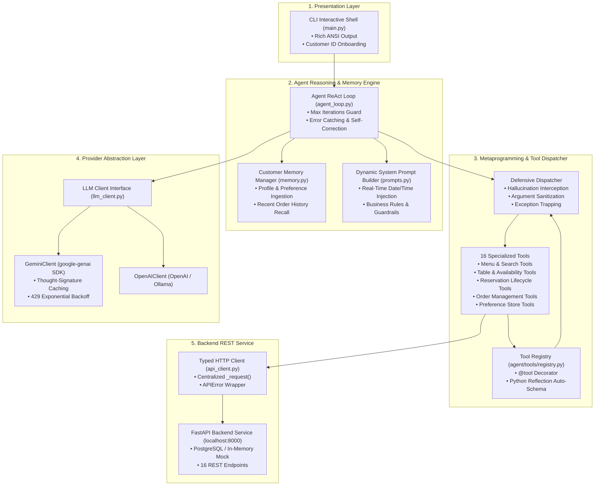
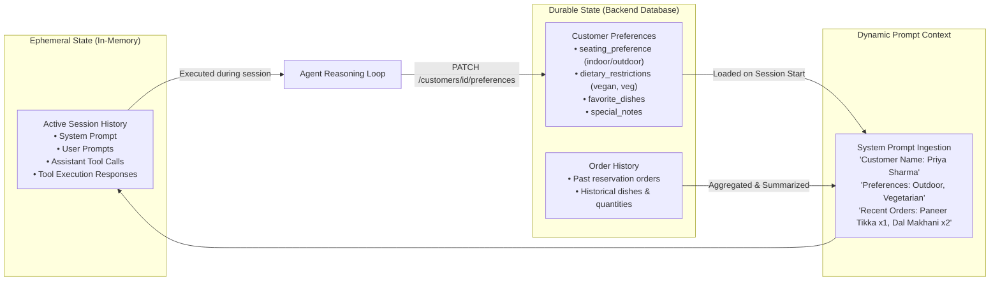

# 🍽️ Autonomous AI Restaurant Reception Agent

[](https://www.python.org/)
[](https://fastapi.tiangolo.com/)
[](https://ai.google.dev/)
[-brightgreen.svg?logo=pytest&logoColor=white)](https://docs.pytest.org/)
[](#architecture)
[](LICENSE)

An enterprise-grade, autonomous AI Receptionist designed for **"The Golden Plate"** restaurant. Built entirely from **first principles** (no heavy LangChain/LangGraph abstractions), the agent converses with customers in natural language, handles end-to-end table bookings, manages food pre-orders, answers complex menu inquiries with dietary constraints, and maintains durable customer memory across sessions.

---

## 📑 Table of Contents

- [Architectural Overview](#-architectural-overview)
- [Agent Execution Flow (ReAct Loop)](#-agent-execution-flow-react-loop)
- [Memory Architecture (Durable vs Ephemeral)](#-memory-architecture-durable-vs-ephemeral)
- [Core Engineering Highlights](#-core-engineering-highlights)
- [Tool Registry & Auto-Schema Metaprogramming](#-tool-registry--auto-schema-metaprogramming)
- [API & Tool Coverage](#-api--tool-coverage)
- [Live Conversation Walkthrough](#-live-conversation-walkthrough)
- [Directory Structure](#-directory-structure)
- [Getting Started](#-getting-started)
  - [Prerequisites](#prerequisites)
  - [1. Backend Setup](#1-backend-setup)
  - [2. Environment Configuration](#2-environment-configuration)
  - [3. Running the Interactive CLI](#3-running-the-interactive-cli)
- [Testing & Deterministic Verification](#-testing--deterministic-verification)
- [Architectural Decisions & FAQ](#-architectural-decisions--faq)

---

## 🏛️ Architectural Overview

The application is structured into four cleanly decoupled layers following the **Dependency Inversion** and **Single Responsibility** principles:



---

## 🔄 Agent Execution Flow (ReAct Loop)

The agent implements an autonomous **Reason + Act (ReAct)** cycle. A single customer request can trigger multiple tool invocations in sequence before formulating a natural language response.

```mermaid
sequenceDiagram
    autonumber
    actor Customer as Customer
    participant CLI as CLI Interface
    participant Loop as Agent Loop
    participant LLM as LLM Client (Gemini/OpenAI)
    participant Dispatcher as Tool Dispatcher
    participant Backend as Restaurant Backend API

    Customer->>CLI: "Book an outdoor table for 3 tonight around 8 PM and add paneer tikka"
    CLI->>Loop: process_message(input)
    Loop->>Loop: Append User Message to History

    rect rgb(240, 245, 255)
        Note over Loop,LLM: Step 1: Check Availability
        Loop->>LLM: chat(history + system_prompt, tools)
        LLM-->>Loop: ToolCall: check_availability(date="2026-08-27", party_size=3)
        Loop->>Dispatcher: dispatch("check_availability", args)
        Dispatcher->>Backend: GET /availability?date=2026-08-27&party_size=3
        Backend-->>Dispatcher: 200 OK: [{table_id: 5, location: "outdoor", slots: ["20:00"]}]
        Dispatcher-->>Loop: Tool Result JSON
        Loop->>Loop: Append Tool Result to History
    end

    rect rgb(240, 255, 245)
        Note over Loop,LLM: Step 2: Create Reservation
        Loop->>LLM: chat(updated_history, tools)
        LLM-->>Loop: ToolCall: create_reservation(table_id=5, time="20:00", party_size=3)
        Loop->>Dispatcher: dispatch("create_reservation", args)
        Dispatcher->>Backend: POST /reservations
        Backend-->>Dispatcher: 201 Created: {id: 42, status: "confirmed"}
        Dispatcher-->>Loop: Tool Result JSON
        Loop->>Loop: Append Tool Result to History
    end

    rect rgb(255, 245, 240)
        Note over Loop,LLM: Step 3: Add Pre-Order Item
        Loop->>LLM: chat(updated_history, tools)
        LLM-->>Loop: ToolCall: add_order_item(reservation_id=42, menu_item_id=1, quantity=1)
        Loop->>Dispatcher: dispatch("add_order_item", args)
        Dispatcher->>Backend: POST /reservations/42/orders
        Backend-->>Dispatcher: 201 Created: {order_id: 10, item: "Paneer Tikka"}
        Dispatcher-->>Loop: Tool Result JSON
        Loop->>Loop: Append Tool Result to History
    end

    rect rgb(250, 250, 250)
        Note over Loop,LLM: Step 4: Final Synthesis
        Loop->>LLM: chat(updated_history, tools)
        LLM-->>Loop: Final Text: "I've booked Table 5 (outdoor) for 3 guests at 8:00 PM (ID: 42) and added 1x Paneer Tikka!"
        Loop->>CLI: Return Response Text
        CLI->>Customer: Display Response to Customer
    end
```

---

## 🧠 Memory Architecture (Durable vs Ephemeral)

A common flaw in naive agent implementations is mixing up conversational context with long-term memory. Our architecture strictly separates them:



1. **Ephemeral Context**: In-memory list of message dictionaries (`role: system | user | assistant | tool`) tracking the current active conversation.
2. **Durable Memory**: Persisted in the backend database via `PATCH /customers/{id}/preferences` and `GET /customers/{id}/orders`. When a returning customer (e.g. Priya Sharma) is identified, their seating preferences, dietary restrictions, and top order items are dynamically synthesized and injected into the system prompt.

---

## ⚡ Core Engineering Highlights

### 1. Metaprogramming with `@tool` Decorator
No manual, error-prone JSON schemas. Tools are standard Python functions decorated with `@tool`:

```python
@tool("Search menu items by category, dietary tags, or maximum price")
def search_menu(category: str = "", dietary_tag: str = "", max_price: float = 0) -> dict:
    """Search and filter menu items dynamically."""
    api = ToolRegistry.get_api_client()
    items = api.get_menu()
    # Client-side filtering logic...
    return {"results": filtered, "count": len(filtered)}
```
The decorator automatically inspects `typing.get_type_hints()` and `inspect.signature()` to generate valid OpenAPI/Gemini parameter specifications at runtime.

### 2. Defensive Tool Dispatcher
The dispatcher acts as an immune system around backend execution:
* **Hallucination Protection**: Intercepts unregistered tool calls and returns a structured schema listing valid tools.
* **Argument Sanitization**: Handles stringified JSON, missing keys, and default fallbacks.
* **Exception Trapping**: Catches `APIError` and network exceptions, returning structured JSON error payloads to the LLM. The model reads the error and self-corrects (e.g. *"Table 1 is booked, checking Table 2..."*) rather than crashing.

### 3. Gemini Thought-Signature Preservation
Modern Gemini models (e.g. `gemini-3.5-flash`, `gemini-2.5-flash`) utilize internal reasoning chains ("thought signatures"). When executing multi-turn tool calling, stripping these signatures triggers `400 INVALID_ARGUMENT`. Our `GeminiClient` caches the raw `Content` object in `LLMResponse._raw_content` and replays it verbatim in subsequent turns.

### 4. Rate-Limit Resilience (Exponential Backoff)
Free-tier LLM endpoints often face transient `429 RESOURCE_EXHAUSTED` spikes during rapid tool-chain executions. The client includes an automatic 3-stage exponential retry mechanism that transparently recovers without interrupting user sessions.

---

## 🛠️ API & Tool Coverage

The agent implements **16 specialized tools** mapped to the complete restaurant backend API:

| Category | Tool Name | API Endpoint | Description |
|---|---|---|---|
| **Menu** | `get_menu` | `GET /menu` | Fetches complete menu with prices, tags & availability |
| | `search_menu` | `GET /menu` | Filters menu by category, dietary tags, and max price |
| **Tables** | `list_tables` | `GET /tables` | Lists all tables, capacities, and locations (indoor/outdoor) |
| | `check_availability` | `GET /availability` | Queries free tables & open 30-min time slots for date/party |
| **Customer** | `lookup_customer` | `GET /customers/lookup` | Finds existing profile by phone number or email |
| | `create_customer` | `POST /customers` | Registers a new customer profile |
| | `get_customer_profile` | `GET /customers/{id}` | Fetches customer details and stored preferences |
| | `update_customer_preferences` | `PATCH /customers/{id}/preferences` | Saves seating, dietary, or custom notes to memory |
| **Reservation** | `create_reservation` | `POST /reservations` | Books table (validates party size, slot time, double-booking) |
| | `get_reservation` | `GET /reservations/{id}` | Retrieves booking status and details |
| | `cancel_reservation` | `DELETE /reservations/{id}` | Cancels reservation (enforces 2-hour cutoff rule) |
| | `get_customer_reservations` | `GET /customers/{id}/reservations` | Lists all historical and upcoming customer bookings |
| **Orders** | `add_order_item` | `POST /reservations/{id}/orders` | Adds dish to reservation (verifies menu item availability) |
| | `get_reservation_orders` | `GET /reservations/{id}/orders` | Lists all pre-ordered food items on a booking |
| | `remove_order_item` | `DELETE /reservations/{id}/orders/{oid}` | Removes pre-ordered dish before slot cutoff |
| | `get_customer_order_history` | `GET /customers/{id}/orders` | Retrieves all past orders across customer history |

---

## 💬 Live Conversation Walkthrough

Below is an authentic trace from the interactive CLI showing **Customer Identification**, **Memory Recall**, **Smart Table Assignment**, **Pre-Ordering**, and **Menu Guardrails**:

```text
============================================================
 🍽️  Welcome to The Golden Plate Restaurant Reception
============================================================

Please enter your phone number or email: +91-9876543210

✨ Welcome back, Priya Sharma!
  Remembered: Seating: outdoor | Dietary: vegetarian

You: i want to book a table at 7:20 pm today

[Agent Step 1] Calling LLM...
Agent: Hello Priya! Our reservation slots run in 30-minute increments. 
       For this evening, would you prefer 7:00 PM or 7:30 PM? 
       Also, how many guests will be in your party? I'll make sure to look for an outdoor table for you!

You: 4 guests at 7:30 pm please

[Agent Step 1] Calling LLM...
 -> [Tool Call] check_availability({'date': '2026-08-27', 'party_size': 4})
 <- [Tool Result] {"date": "2026-08-27", "party_size": 4, "available_tables": [{"table_id": 5, "capacity": 4, "location": "outdoor", "available_slots": ["19:30", ...]}]}

[Agent Step 2] Calling LLM...
 -> [Tool Call] create_reservation({'customer_id': 1, 'table_id': 5, 'date': '2026-08-27', 'time': '19:30', 'party_size': 4})
 <- [Tool Result] {"id": 3, "customer_id": 1, "table_id": 5, "date": "2026-08-27", "time": "19:30", "party_size": 4, "status": "confirmed"}

[Agent Step 3] Calling LLM...
Agent: Wonderful! I've booked Table 5 (Outdoor, seats 4) for today at 7:30 PM. 
       Your Reservation ID is 3.
       Would you like to pre-order any dishes? Last time you enjoyed our Paneer Tikka and Dal Makhani.

You: Yes, add 2 Paneer Tikka and 1 Dal Makhani. Also can you add Champagne?

[Agent Step 1] Calling LLM...
 -> [Tool Call] get_menu({})
 <- [Tool Result] {"menu_items": [{"id": 1, "name": "Paneer Tikka", "price": 350.0}, {"id": 5, "name": "Dal Makhani", "price": 400.0}, ...]}

[Agent Step 2] Calling LLM...
 -> [Tool Call] add_order_item({'reservation_id': 3, 'menu_item_id': 1, 'quantity': 2})
 <- [Tool Result] {"id": 6, "menu_item_name": "Paneer Tikka", "quantity": 2, "price": 350.0}

[Agent Step 3] Calling LLM...
 -> [Tool Call] add_order_item({'reservation_id': 3, 'menu_item_id': 5, 'quantity': 1})
 <- [Tool Result] {"id": 7, "menu_item_name": "Dal Makhani", "quantity": 1, "price": 400.0}

[Agent Step 4] Calling LLM...
Agent: I've added 2x Paneer Tikka (₹700) and 1x Dal Makhani (₹400) to your reservation #3!
       Regarding champagne, I apologize but we do not serve alcoholic beverages. 
       We do have a delicious Mango Lassi (₹150) if you'd like a beverage. See you at 7:30 PM! 🍽️
```

---

## 📁 Directory Structure

```text
radiant-pasteur/
├── main.py                         # Production CLI Entrypoint (Rich UI)
├── requirements.txt                # Production Dependencies
├── .env.example                    # Environment Template
├── README.md                       # Comprehensive Technical Documentation
│
├── agent/                          # Production Agent Package (~2,000 LOC)
│   ├── __init__.py
│   ├── config.py                   # Centralized Environment Configuration
│   ├── api_client.py               # Typed HTTP Client (httpx) with APIError
│   ├── llm_client.py               # Gemini 3.5 & OpenAI Provider Adapters
│   ├── agent_loop.py               # Core ReAct Execution Loop & Safeguards
│   ├── memory.py                   # Customer Memory & Preference Ingestion
│   ├── prompts.py                  # Dynamic System Prompt Templates
│   └── tools/                      # Modular Tool Implementations
│       ├── __init__.py
│       ├── registry.py             # @tool Decorator & Reflection Schema Gen
│       ├── menu_tools.py           # get_menu, search_menu
│       ├── table_tools.py          # list_tables, check_availability
│       ├── customer_tools.py       # lookup, create, profile, update_preferences
│       ├── reservation_tools.py    # create, get, cancel, customer_reservations
│       └── order_tools.py          # add, get, remove, customer_order_history
│
├── doable/                         # Lean Live-Coding Reference (~370 LOC)
│   ├── api_client.py               # Compact HTTP Client
│   ├── tools.py                    # Consolidated Tool Registry & 8 Core Tools
│   ├── llm_client.py               # Compact LLM Provider
│   ├── agent_loop.py               # Compact ReAct Loop
│   ├── main.py                     # Compact CLI
│   ├── test_agent.py               # Compact Unit Test Suite
│   └── STUDY_GUIDE.md              # 90-Minute Live Coding Cheat Sheet
│
├── mock_backend/                   # In-Memory Backend Replica (FastAPI)
│   ├── app.py                      # 16 REST Endpoints & Business Rule Engine
│   ├── models.py                   # Pydantic Schemas
│   └── seed_data.py                # 8 Tables, 12 Menu Items, 3 Customers
│
└── tests/                          # Production Pytest Suite (52 Tests)
    ├── conftest.py                 # StubLLM & MockAPI Fixtures
    ├── test_tool_registry.py       # Registry & Schema Generation Tests
    ├── test_tools.py               # Tool Unit Tests
    ├── test_agent_loop.py          # Multi-Step ReAct Loop Tests
    ├── test_memory.py              # Customer Memory Tests
    └── test_error_handling.py      # Defensive Error Trapping Tests
```

---

## 🚀 Getting Started

### Prerequisites
* **Python**: 3.11 or 3.12 installed
* **Docker Desktop**: (Optional, for running real containerized backend)
* **Google Gemini API Key**: [Get a free key here](https://aistudio.google.com/app/apikey)

### 1. Backend Setup

#### Option A: Dockerized Backend (Official Round Setup)
```bash
cd restaurant-api
docker compose up -d --build
```

#### Option B: Standalone Mock Backend (Local Practice)
```bash
python -m mock_backend.app
```
*Verify backend health*:
```bash
curl http://localhost:8000/health
# Output: {"status": "ok"}
```

### 2. Environment Configuration

Create a `.env` file in the root directory:
```ini
BACKEND_URL=http://localhost:8000
LLM_PROVIDER=gemini
LLM_MODEL=gemini-3.5-flash
GOOGLE_API_KEY=AIzaSy...your-gemini-key...
VERBOSE=false
MAX_ITERATIONS=15
```

### 3. Running the Interactive CLI

Install dependencies:
```bash
pip install -r requirements.txt
```

Launch the agent:
```bash
# Run with Gemini (Default)
python main.py

# Run with verbose tool reasoning trace
python main.py --verbose

# Run with OpenAI
python main.py --provider openai --model gpt-4o-mini
```

---

## 🧪 Testing & Deterministic Verification

The repository includes a comprehensive, deterministic test suite utilizing the **`StubLLM`** and **`MockAPI`** patterns. **Zero real LLM calls are made during testing**, guaranteeing 100% reproducibility in CI environments with zero API cost.

```bash
# Run complete test suite
python -m pytest tests/ doable/test_agent.py -v
```

### Test Suite Summary:
```text
============================= test session starts =============================
platform win32 -- Python 3.12.8, pytest-9.1.1
collected 56 items

tests/test_tool_registry.py::TestToolRegistration ... PASSED (9/9)
tests/test_tools.py::TestMenuTools ................ PASSED (14/14)
tests/test_agent_loop.py::TestAgentLoopWithTools .. PASSED (8/8)
tests/test_memory.py::TestCustomerMemory .......... PASSED (7/7)
tests/test_error_handling.py::TestErrors .......... PASSED (8/8)
doable/test_agent.py::TestLeanAgent ............... PASSED (4/4)

============================= 56 passed in 0.39s ==============================
```

---

## ❓ Architectural Decisions & FAQ

### Q1: Why build a custom agent harness instead of LangChain or LangGraph?
* **First Principles & Transparency**: Frameworks like LangChain add complex abstraction layers, unpredictable state machines, and breaking dependency churn. Building a lightweight harness from scratch gives 100% control over execution latency, error handling, and prompt serialization.
* **Native Tool-Use**: Frontier LLMs (Gemini, GPT-4o, Claude 3.7) provide native function calling at the API layer. Framework wrappers are largely redundant overhead for structured ReAct loops.
* **Deterministic Unit Testing**: Our custom harness allows full end-to-end multi-turn testing with `StubLLM` in **0.39 seconds**.

### Q2: Why direct REST API tool calling instead of RAG (Vector Search)?
* **Relational Exactness**: Restaurant operations demand strict transactional determinism. You cannot "approximate" table availability or prices via vector cosine similarity. A database query via `GET /availability` guarantees real-time accuracy and eliminates double-booking hallucinations.

### Q3: How is double-booking prevented?
* **Backend Invariant Enforcement**: The backend API enforces table capacity and unique `(table_id, date, time)` slots.
* **Defensive Tool Recovery**: If a booking conflict occurs, the backend returns `409 Conflict`. The dispatcher catches this and supplies `{"error": "Table already booked"}` back to the LLM, prompting the agent to check alternative tables or time slots autonomously.

---

## 📄 License
This project is licensed under the MIT License — see the [LICENSE](LICENSE) file for details.
